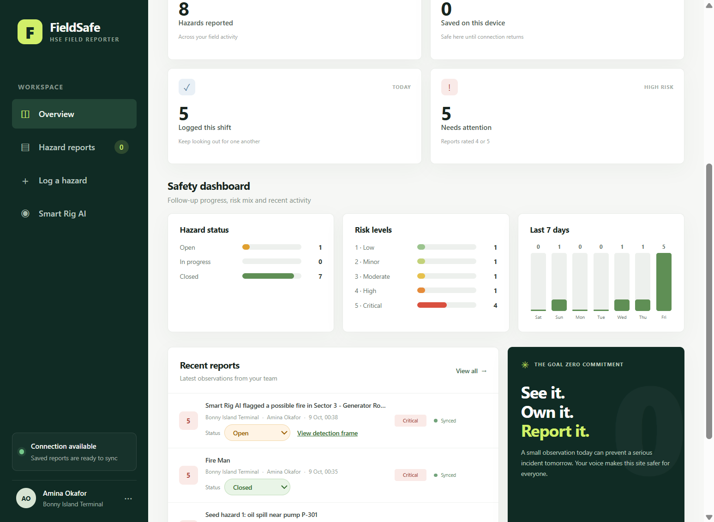
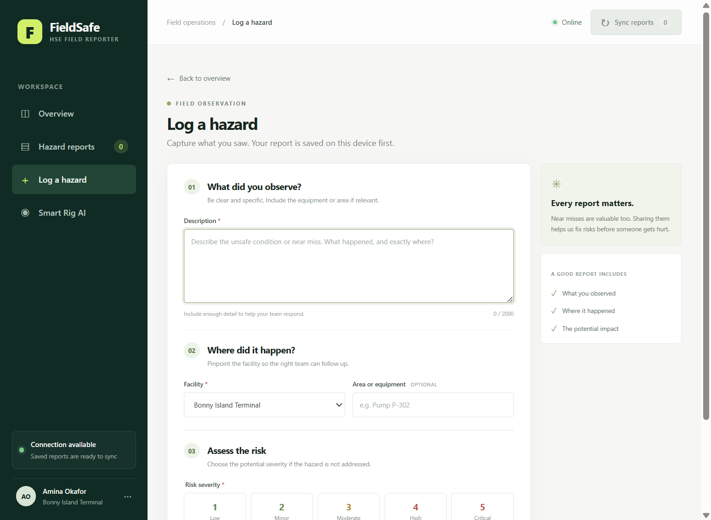
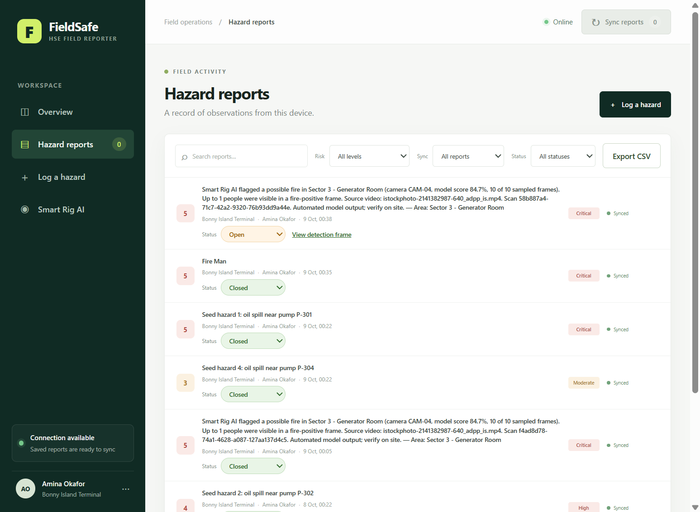
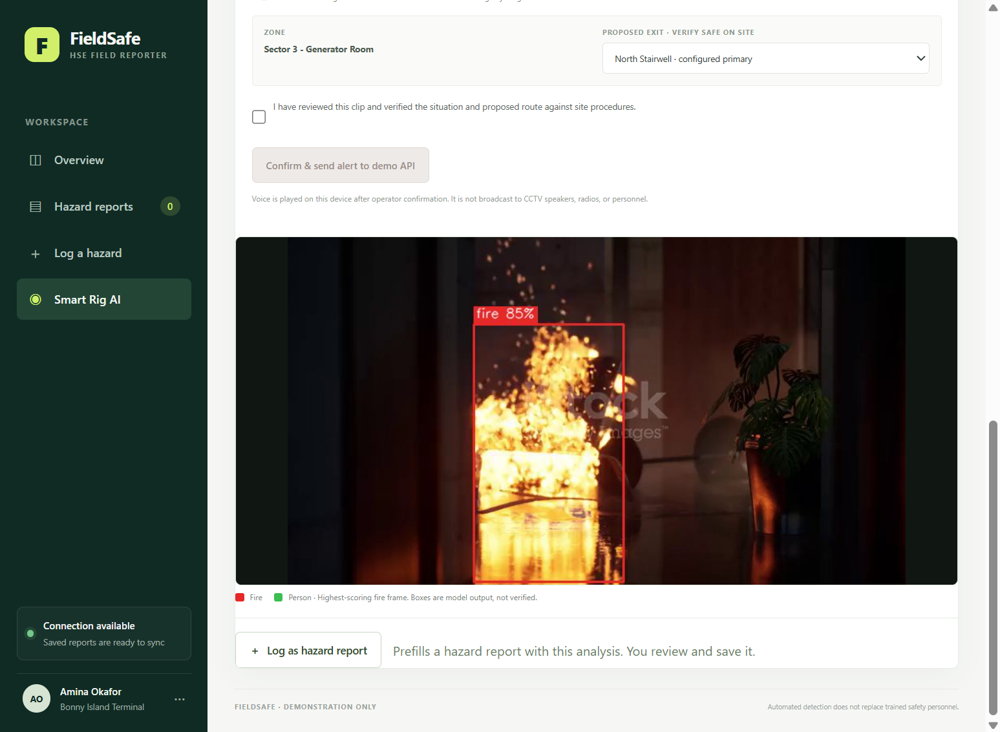

# FieldSafe — HSE Field Reporter


FieldSafe is an **offline-first hazard-reporting web app** for oil-and-gas field crews, with an **AI video-analysis assistant (Smart Rig AI)** that spots possible fire and people in recorded footage and turns the result into a hazard report with annotated evidence.

- **Installable PWA** — a static HTML/CSS/JS front end that stores reports in the browser (IndexedDB), so crews can report with no signal.
- **Django REST backend** — JWT login and idempotent batch sync of hazard reports.
- **Smart Rig AI** — YOLO-based fire and person detection on uploaded or camera-recorded video, with mandatory operator review.
- **Follow-up workflow** — Open → In progress → Closed, a safety dashboard and CSV export.



> **Prototype only.** FieldSafe is a demonstration, not a certified safety or emergency system. See [Known limitations](#known-limitations).

---

## Contents

1. [Quick start](#quick-start)
2. [Using the app](#using-the-app)
3. [Smart Rig AI setup](#smart-rig-ai-setup)
4. [API reference](#api-reference)
5. [Configuration](#configuration)
6. [Testing and CI](#testing-and-ci)
7. [Project layout](#project-layout)
8. [Known limitations](#known-limitations)

---

## Quick start

Requires **Python 3.12+** and a modern browser. The commands below are for Windows PowerShell.

### 1. Install and start the backend

```powershell
python -m venv .venv
.\.venv\Scripts\Activate.ps1
python -m pip install -r requirements.txt

python manage.py migrate
python manage.py createsuperuser
python manage.py runserver
```

`migrate` also seeds the demo catalog of sites and employees. The API is now at `http://127.0.0.1:8000`.

### 2. Serve the web app

In a **second terminal** in the same folder:

```powershell
python -m http.server 5500
```

Open <http://127.0.0.1:5500>.

### 3. Connect the app to the backend

1. Click the profile at the bottom of the sidebar to open **Field settings**.
2. Choose who you are reporting as and your default facility.
3. Set **Sync API address** to `http://127.0.0.1:8000/api/v1`.
4. Enter the username and password of the account you created, then click **Sign in to sync**.

You should see "Signed in as …" and a "Connected" message. The app works without this step, but reports then stay on the device and Smart Rig AI is unavailable.

> **Field accounts:** a non-admin account can only sync reports for its own employee. In the admin site (`http://127.0.0.1:8000/admin/`) create the user and link it to an `Employee` record. Superusers can sync for any employee.

---

## Using the app

The sidebar has four areas: **Overview**, **Hazard reports**, **Log a hazard** and **Smart Rig AI**.

### Log a hazard



1. Open **Log a hazard** (or use the button on the Overview page).
2. Describe what you saw, including the equipment or area.
3. Pick the **facility** and, optionally, the area or equipment.
4. Choose a **risk severity** from 1 (Low) to 5 (Critical).
5. Click **Save hazard report**.

The report is saved on the device first and marked **Awaiting sync**. It never needs a connection to be saved.

### Sync reports

Click **Sync reports** in the top bar. The button shows how many reports are waiting. Syncing needs a signed-in session and a reachable server; when the server confirms a report, its badge changes to **Synced**. Syncing is idempotent, so retrying never creates duplicates, and the original event time is preserved.

If sync fails, the reports stay safely on the device. Check that the backend is running and that you are signed in under **Field settings**.

### Hazard reports, follow-up and export



- **Search and filter** by text, risk level, sync state and status.
- **Status:** use the dropdown on each report to move it through **Open → In progress → Closed**. A status change is saved immediately and queued for sync.
- **View detection frame:** reports created from Smart Rig AI carry the annotated frame; click the link to open it full size.
- **Export CSV:** downloads every report on the device, including status. Cells that start with `=`, `+`, `-` or `@` are prefixed so spreadsheets cannot run them as formulas.

### Overview and safety dashboard

The Overview page shows totals, items awaiting sync and high-risk counts, plus a dashboard with hazard status, risk levels and the last 7 days of activity. Everything is computed on the device, so it works offline.

### Smart Rig AI



Smart Rig AI analyzes a **recorded clip** (it does not watch live CCTV). You must be signed in, and the backend needs a model (see [Smart Rig AI setup](#smart-rig-ai-setup)).

1. Open **Smart Rig AI** and pick the **camera / zone**. The configured primary and alternate exits for that zone appear below.
2. Adjust the **minimum model confidence** if needed. This is a detection score threshold, not a probability that there is a fire.
3. Either **choose a recording** (MP4, MOV, AVI or MKV, up to 100 MB and 300 seconds) or tap **Record video with camera** on a phone.
4. Click **Analyze recording**. The video is processed on the server in a temporary folder and is not kept.
5. Read the **Analysis review**: fire signal and highest score, the maximum number of people in a fire-positive frame, and how many frames were sampled. When fire is found you also get the **highest-scoring frame with boxes** drawn around detected fire (red) and people (green).
6. Choose what to do with the result:
   - **Log as hazard report** — prefills the Log a hazard form with the zone, a risk of 5 (fire with people) or 4 (fire without people), and attaches the annotated frame. Review it and click **Save hazard report**.
   - **Confirm & send alert to demo API** — tick the review checkbox, choose the exit you have verified on site, then send. The alert is only recorded in the Django database; nothing contacts an emergency service. The spoken prompt plays on your own device only.

If the model finds no fire, you can still log the clip as a hazard report, but no evidence frame is attached.

---

## Smart Rig AI setup

Smart Rig AI needs one or two YOLO models. Weights are **not** bundled or downloaded automatically, and the standard COCO `yolov8n.pt` model has no fire class, so it cannot detect fire on its own.

Create a `models` folder (git-ignored) and set the paths before starting Django:

```powershell
$env:VISION_MODEL_PATH        = "models\fire.pt"        # a model with a fire / flame class
$env:VISION_PERSON_MODEL_PATH = "models\yolov8n.pt"     # optional, adds the person class
python manage.py runserver
```

- `VISION_MODEL_PATH` must contain a class named `fire` or `flame` (change this with `VISION_FIRE_CLASS_NAMES`, a comma-separated list). If the same model also detects `person`, that is enough.
- `VISION_PERSON_MODEL_PATH` is optional. When the fire model has no `person` class, this second model counts people in fire-positive frames. Use `VISION_PERSON_CLASS_NAME` if its person class has a different name.
- The Smart Rig AI page shows whether the runtime and model are ready. Without a compatible model the server returns a clear "unavailable" error instead of pretending no fire was found.

Check the licence of any weights you use. Ultralytics YOLO models are AGPL-3.0 unless you hold a commercial licence, and community models have their own terms. Community fire models are unvalidated; do not use one to direct real-world emergency response.

**Camera zones and exits** are defined in [`floorplan.json`](./floorplan.json): camera IDs, zones, site IDs and the two exit options. This is a static reference, not a live indoor map or a route calculation, and the server checks submitted camera and exit IDs against it.

**Limits:** videos up to 100 MB and 300 seconds, at most 120 frames sampled at about one-second intervals. The people figure is the highest count in a single fire-positive frame, not a unique-person count.

---

## API reference

Base URL: `http://127.0.0.1:8000`. All `/api/v1/` endpoints need `Authorization: Bearer <access token>`.

| Method | Endpoint | Purpose |
| --- | --- | --- |
| `POST` | `/api/token/` | Log in with `username` and `password`; returns `access` and `refresh` tokens |
| `POST` | `/api/token/refresh/` | Exchange a refresh token for a new access token |
| `GET` | `/api/v1/sites/` | Site catalog |
| `GET` | `/api/v1/employees/` | Employee catalog |
| `POST` | `/api/v1/hazards/sync/` | Idempotently upsert up to 100 hazard reports |
| `GET` | `/api/v1/vision/status/` | Is the vision runtime and model ready? |
| `GET` | `/api/v1/vision/cameras/` | Camera zones and exits from `floorplan.json` |
| `POST` | `/api/v1/vision/analyze/` | Analyze an uploaded video (multipart `video`, `camera_id`, optional `confidence`) |
| `POST` | `/api/v1/vision/alerts/` | Record an operator-confirmed alert for a fire-positive scan |

**Sync body**

```json
{
  "device_id": "browser-1",
  "reports": [
    {
      "report_id": "UUID",
      "employee_id": "UUID",
      "site_id": "UUID",
      "description": "Oil spill near pump P-302",
      "risk_score": 4,
      "local_timestamp": "2026-10-09T00:22:00+01:00",
      "status": "open",
      "evidence_frame": "data:image/jpeg;base64,..."
    }
  ]
}
```

`status` (`open`, `in_progress` or `closed`) and `evidence_frame` (a JPEG data URL up to 400 KB) are optional. A successful response lists `synced_report_ids` with `created` and `updated` counts. Re-sending a report updates it; an omitted `status` or `evidence_frame` leaves the stored value unchanged.

---

## Configuration

Set these as environment variables before `runserver`.

| Variable | Purpose | Default |
| --- | --- | --- |
| `DJANGO_SECRET_KEY` | Django secret key | development-only value |
| `DJANGO_DEBUG` | `false` for any real deployment | `true` |
| `DJANGO_ALLOWED_HOSTS` | Comma-separated host names | local only |
| `DJANGO_CORS_ALLOWED_ORIGINS` | Origins allowed to call the API | local dev origins |
| `VISION_MODEL_PATH` | Fire model weights | unset (AI disabled) |
| `VISION_PERSON_MODEL_PATH` | Optional second model for people | unset |
| `VISION_FIRE_CLASS_NAMES` | Fire class names | `fire,flame` |
| `VISION_PERSON_CLASS_NAME` | Person class name | `person` |

**Before any real deployment:** set a strong `DJANGO_SECRET_KEY`, `DJANGO_DEBUG=false`, restrict hosts and CORS, move to PostgreSQL, and serve the site over HTTPS. The bundled settings and seeded catalog are for local development.

---

## Testing and CI

```powershell
python manage.py check
python manage.py makemigrations --check --dry-run
python manage.py test reports
node --check app.js
node --check sw.js
```

The Django suite (23 tests) covers authentication, idempotent sync, status and evidence handling, camera and exit validation, and the vision pipeline with the model mocked. [GitHub Actions](./.github/workflows/ci.yml) runs the same checks on every push and pull request.

---

## Project layout

| Path | What it is |
| --- | --- |
| `index.html`, `styles.css`, `app.js` | The single-page web app |
| `sw.js`, `manifest.webmanifest`, `icon.svg` | PWA offline cache and install metadata |
| `config/` | Django settings and URLs |
| `reports/` | Models, API, admin, vision pipeline (`vision.py`) and tests |
| `floorplan.json` | Camera zones and exit options |
| `docs/` | Screenshots used in this README |
| `models/` | Your local model weights (git-ignored) |

---

## Known limitations

- Detection accuracy of any community fire model has not been validated on rig footage; treat results as a prompt for human review, never as proof.
- Evidence frames are stored as base64 text in the database for simplicity; a production build would use object storage.
- Only two access levels (field user and admin) and no role-based permissions or audit trail.
- No deployment configuration (Docker, PostgreSQL, HTTPS) is included yet.
- The browser keeps reports in IndexedDB; clearing site data removes anything not yet synced.
- There are no automated front-end or end-to-end tests; the front end is only syntax-checked in CI.
